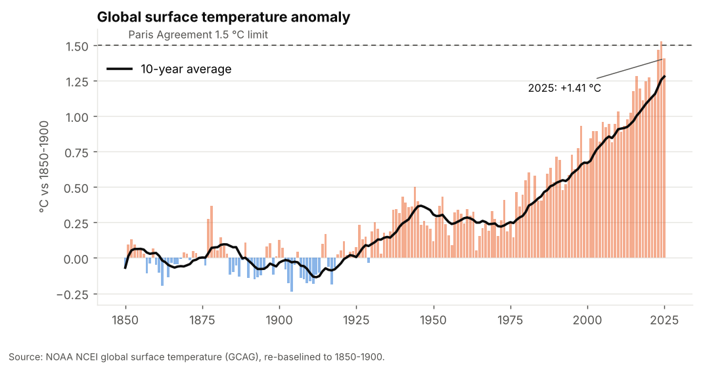
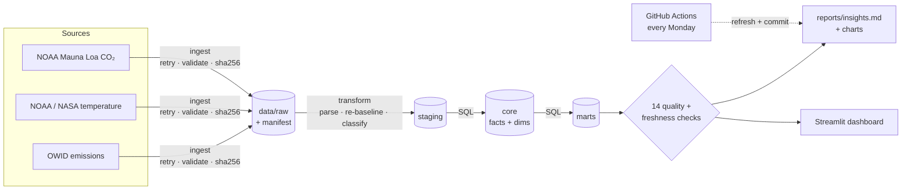
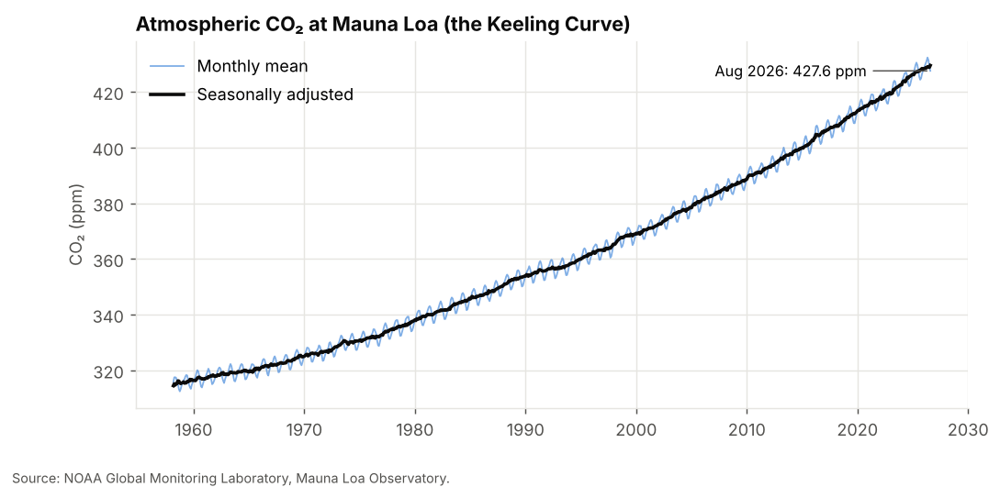
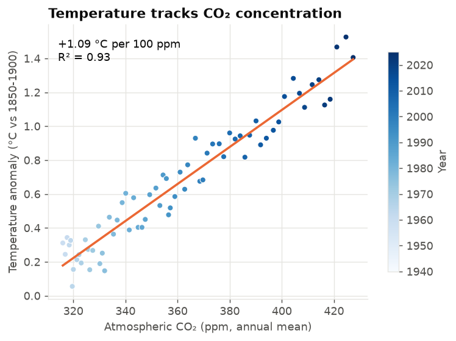
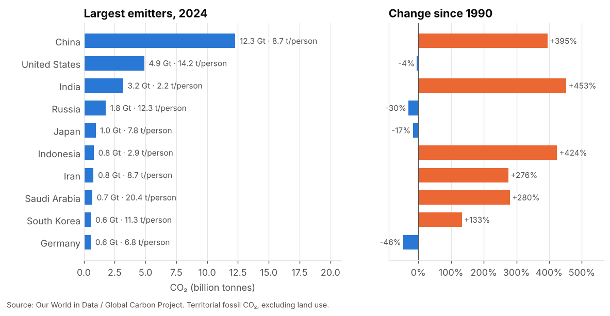
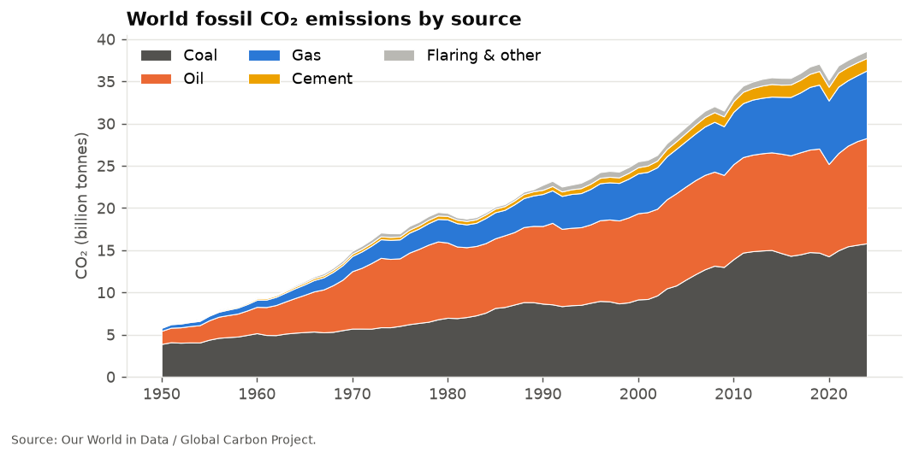

# Climate & Emissions Tracker


An automated data pipeline that combines three authoritative public climate datasets into one analytics
warehouse, then answers: **How fast is the planet warming? How closely does warming track CO₂? Who emits,
and who is actually cutting?**

A scheduled GitHub Actions job re-downloads every source each week, rebuilds the warehouse, re-runs the
quality checks and commits a refreshed report, so the charts and findings in this repo stay current on their own.

**Live dashboard: [madhubuddaraju.github.io/climate-emissions-tracker](https://madhubuddaraju.github.io/climate-emissions-tracker/)**
· **Latest findings (auto-updated): [`reports/insights.md`](reports/insights.md)**



---

## Data sources

| Dataset | Publisher | Coverage | Updates |
|---|---|---|---|
| [CO₂ and greenhouse gas emissions](https://github.com/owid/co2-data) | Our World in Data / Global Carbon Project | 218 countries + regions, 1750-present | Yearly |
| [Global surface temperature](https://github.com/datasets/global-temp) | NOAA NCEI (GCAG) and NASA GISS (GISTEMP) | Monthly, 1850-present | Monthly |
| [Atmospheric CO₂, Mauna Loa](https://github.com/datasets/co2-ppm) | NOAA Global Monitoring Laboratory | Monthly, 1958-present | Monthly |

No API keys are needed. Every download is checksummed and logged in `audit.sources`, so each run records
whether upstream data actually changed.

## Architecture



| Layer | Tables |
|---|---|
| `staging` | `stg_emissions`, `stg_temperature`, `stg_co2_ppm` |
| `core` | `dim_entity`, `fct_emissions` (entity x year), `fct_temperature_monthly`, `fct_co2_monthly` |
| `marts` | `annual_climate`, `decade_summary`, `country_emissions_latest`, `decoupling`, `fuel_mix`, `co2_growth`, `regional_emissions` |
| `audit` | `sources`, `rejects`, `dq_results`, `pipeline_runs` |

## What the analysis covers

| Chart | |
|---|---|
|  |  |
|  |  |

- **Warming rate**: least-squares trend since 1975 and a straight-line estimate of when the 10-year average
  crosses 1.5 °C (clearly labelled as an extrapolation, not a climate model).
- **Temperature vs CO₂**: regression of annual temperature anomaly on Mauna Loa concentration (°C per 100 ppm, R²).
- **Accumulation speed**: December-to-December growth of seasonally adjusted CO₂, by decade.
- **Country scorecard**: total, per-person, share of world, change since 1990, 2005 and the 2015 Paris
  Agreement, and consumption-based vs territorial emissions (who "imports" emissions through trade).
- **Decoupling**: which countries grew GDP while cutting CO₂ (absolute), grew emissions slower than GDP
  (relative), or neither.

## Data engineering details

**Making temperature series comparable.** NOAA reports anomalies against 1901-2000 and NASA against
1951-1980. Both are re-baselined to **1850-1900**, the IPCC "pre-industrial" reference the Paris targets
use. GISTEMP starts in 1880, so it is aligned to the NOAA series over their 1951-1980 overlap. A quality
check asserts the 1850-1900 mean is exactly 0.

**Not double counting.** OWID mixes countries with continents, income groups and "(GCP)" variants in the
same table. Entities are classified as `country`, `region` or dropped (logged in `audit.rejects`), and a
check verifies that countries + international aviation and shipping reconcile to the World total within 5%.

**Messy upstream formats.** The Mauna Loa file's header has fewer names than data columns and uses
`-99.99` / `-9.99` sentinels for missing values; both are handled explicitly and tested.

**Freshness monitoring.** Warn-level checks fail if temperature or CO₂ data is more than 120 days old, or
emissions more than 3 years behind, which catches a source that silently stops updating.

**Offline, fast tests.** Tests run on small fixtures cut from the real files (`make fixtures`), so CI checks
logic without depending on the network, then a separate CI step runs against the live sources.

## Quick start

```bash
git clone https://github.com/madhubuddaraju/climate-emissions-tracker.git
cd climate-emissions-tracker
python -m venv .venv && source .venv/bin/activate
make install

make all          # download data -> build warehouse -> report -> tests (under a minute)
make dashboard    # interactive dashboard at http://localhost:8501
make refresh      # force a fresh download, ignoring the 12-hour cache
```

Query the warehouse directly:

```bash
duckdb data/climate.duckdb "SELECT entity, co2_mt, co2_t_per_capita FROM marts.country_emissions_latest LIMIT 10"
```

## Project structure

```
├── src/climate/
│   ├── config.py        # sources, paths, reference period
│   ├── ingest.py        # download with retries, validation, checksums, cache
│   ├── transform.py     # parsing, re-baselining, entity classification
│   ├── load.py          # DuckDB loading + SQL model runner
│   ├── quality.py       # integrity, reconciliation and freshness checks
│   └── run.py           # orchestrator / CLI
├── sql/core/            # facts and dimensions
├── sql/marts/           # analysis-ready tables
├── analysis/report.py   # charts + auto-generated insights.md
├── dashboard/app.py     # Streamlit dashboard
├── tests/               # unit + pipeline tests on real-data fixtures
└── .github/workflows/
    ├── ci.yml           # lint, tests, live run on every push
    └── refresh.yml      # weekly refresh that commits updated reports
```

## Limitations

- Emissions are territorial fossil and industry CO₂ (excluding land use change) unless stated; consumption-based
  estimates lag by about a year.
- GDP in the OWID dataset currently ends earlier than emissions, so decoupling uses the latest year with both.
- The 1.5 °C crossing year is a linear extrapolation for illustration only.

## License

Code: MIT. Data remains under its publishers' terms (OWID data is CC BY 4.0; NOAA and NASA data are public domain).
